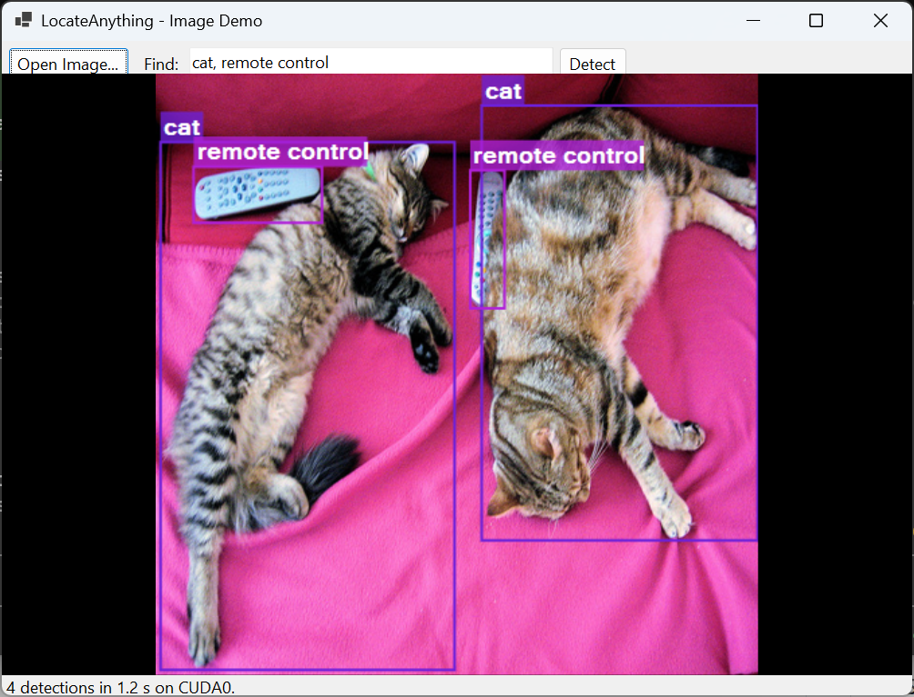

# LocateAnythingSharp

**.NET bindings for NVIDIA's LocateAnything-3B — text-prompted, open-vocabulary
object detection that runs fully local, from single images to live camera
streams.**

Describe what you want to find in plain language ("cat", "remote control",
"the red button in the corner") and get labeled bounding boxes back. No cloud,
no fixed class list: inference runs on your machine through a native engine,
on NVIDIA GPUs (RTX 20 series and newer) with automatic CPU fallback.

| Image demo |
| --- |
|  |

## Highlights

- **Open vocabulary** - detect anything you can describe; categories are free
  text, not a trained class list.
- **Fully local** - a single native DLL runs the model; no Python runtime, no
  network calls, images never leave the machine.
- **GPU with graceful fallback** - one binary embeds CUDA kernels for RTX
  20/30/40/50 series (plus PTX for future GPUs). At runtime it picks the GPU if
  present, otherwise CPU. If an NVIDIA GPU exists but its driver is missing,
  the apps offer to open the driver download page.
- **Simple C# API** - load once, detect per image, get typed results.
- **Live video pattern included** - the camera demo shows how to keep a stream
  smooth while a heavyweight detector evaluates the newest frame continuously.

## Quick start

Prerequisites: git, the .NET 10 SDK, and Visual Studio with the C++ CMake
tools workload. The NVIDIA CUDA Toolkit is optional - with it the engine is
built with GPU kernels, without it the build is CPU-only.

```bat
setup.bat
```

One command builds everything: it clones and patches the native engine, builds
it (CUDA multi-arch when the toolkit is present), downloads the model weights
(~6.3 GB, skipped when already there), builds the .NET solution, and copies
the native DLLs next to the demos. Re-running is safe - each step skips work
already done.

Then try a demo:

```powershell
# GUI: open an image, type categories, see boxes
dotnet\LocateAnything.Demo.Image\bin\Debug\net10.0-windows\LocateAnything.Demo.Image.exe

# GUI: live camera with continuous detection
dotnet\LocateAnything.Demo.Camera\bin\Debug\net10.0-windows\LocateAnything.Demo.Camera.exe

# Console: one image, timed runs
dotnet run --project dotnet\LocateAnything.Demo --no-build -- photo.jpg "person,car" 3
```

## Using the library

```csharp
using Mori.LocateAnything;

using var engine = LocateEngine.Load("locate-anything-q8_0.gguf");
Console.WriteLine($"device: {engine.DeviceName}");   // "CUDA0" or "cpu"

var boxes = engine.Locate("street.jpg", LocateEngine.PromptFor("person", "car"));
foreach (var d in boxes)
    Console.WriteLine(d);                            // person [x1,y1,x2,y2]
```

`LocateEngine` wraps the native context: `Load` reads the GGUF model and
uploads it to the compute device (a few seconds, do it once), `Locate` accepts
a file path or encoded image bytes and returns `Detection` records with label
and pixel coordinates. See [dotnet/README.md](dotnet/README.md) for the full
API surface, GPU behavior, and the model-resolution rules shared by all demos.

## Performance

Measured on an RTX 5090 laptop GPU with the recommended q8_0 weights, hybrid
decode mode, a 448 px image with 4 detections:

| | Model load (once) | Per image |
| --- | --- | --- |
| GPU (CUDA) | ~3.5 s | **~1.0 s** |
| CPU (Ryzen-class, 16 threads) | ~2 s | ~7 s |

Decoding cost scales with the number of objects found: sparse scenes are
faster, dense scenes slower. For live video, run detection on the newest frame
in the background (as the camera demo does) rather than per-frame.

## Repository layout

| Path | Contents |
| --- | --- |
| `dotnet/` | C# solution: `Mori.LocateAnythingSharp` bindings + console, image, and live-camera demos. |
| `scripts/` | `setup.ps1` (full environment setup), `pack.ps1` (NuGet packages), `package-native.ps1` (native DLL packaging), `capture-window.ps1` (README screenshots). |
| `patches/` | Windows-port patch for the third-party C++ engine (symbol exports, device-name API). |
| `setup.bat` | One-shot setup - runs `scripts/setup.ps1`. |
| `docs/` | Screenshots and example output. |
| `locate-anything.cpp/` | *(not in git)* Clone of the native engine, patched and built locally. |
| `models/` | *(not in git)* GGUF model weights. |

## How it works

The heavy lifting is NVIDIA's LocateAnything-3B, a 3-billion-parameter
vision-language model that emits bounding boxes as coordinate tokens. This
repository builds it into a self-contained Windows DLL via the
[locate-anything.cpp](https://github.com/mudler/locate-anything.cpp) inference
engine (C++/ggml - validated box-identical to the official implementation),
and layers a small, safe C# API on top through P/Invoke. The `patches/` folder
carries the Windows-specific fixes until they land upstream.

## License

Code in this repository: Copyright © 2026 Cristian Mori, licensed under the
[Apache License 2.0](LICENSE).

Third-party components keep their own licenses:

- [locate-anything.cpp](https://github.com/mudler/locate-anything.cpp) - MIT license.
- NVIDIA CUDA runtime DLLs - NVIDIA redistributable license.
- Model weights derived from
  [nvidia/LocateAnything-3B](https://huggingface.co/nvidia/LocateAnything-3B) -
  NVIDIA model license, **non-commercial use only** at the time of writing.
  Review it before shipping anything commercial.
